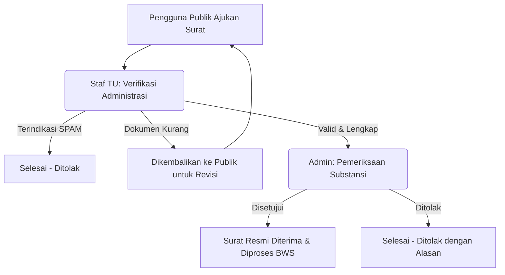

<div align="center">
  <div style="background: #f5b821; width: 64px; height: 64px; border-radius: 20px 4px 20px 4px; display: inline-flex; align-items: center; justify-content: center; margin-bottom: 12px;">
    <span style="color: #024059; font-size: 40px; font-family: Georgia, serif; font-weight: 900;">S</span>
  </div>
  <h1> SAPA</h1>
  <p><b>Sistem Administrasi Permohonan Antar Instansi E-Government</b></p>
  <p>Balai Wilayah Sungai (BWS) Bali Penida</p>

  
  
  
  
</div>

<br/>

## 📖 Tentang SAPA
**SAPA** adalah aplikasi E-Government yang dirancang untuk memfasilitasi pelayanan administrasi surat atau permohonan eksternal dari masyarakat, desa adat, dan instansi lain kepada Balai Wilayah Sungai (BWS) Bali Penida.

Sistem ini mendigitalisasi proses pengajuan dokumen sehingga menjadi jauh lebih terstruktur, transparan, dan mudah dilacak. Dilengkapi dengan **Sistem Verifikasi Berlapis**, portal pelacakan resi, hingga **Role-Based Access Control (RBAC)** untuk memastikan surat diproses oleh pihak yang berwenang.

---

## ✨ Fitur Unggulan

<details>
<summary><b>🚪 1. Portal Publik & Lacak Resi</b> (Klik untuk detail)</summary>

Sistem memisahkan akses untuk masyarakat umum (Pemohon) dan staf internal.
- Pemohon dapat mendaftar akun, melengkapi profil instansi, dan mengajukan surat beserta dokumen lampiran PDF.
- **Lacak Surat:** Pemohon diberikan kode resi unik untuk melacak status perjalanan suratnya secara real-time dari Dashboard maupun halaman pelacakan publik.
</details>

<details>
<summary><b>🛡️ 2. Role-Based Access Control (RBAC)</b> (Klik untuk detail)</summary>

Memiliki hierarki peran pengguna yang sangat ketat:
- **Pengguna Publik:** Hanya bisa mengajukan surat, melacak status, dan mengunggah revisi dokumen.
- **Staf TU:** Bertugas melakukan verifikasi awal (administrasi). Dapat menolak surat indikasi *SPAM*, mengembalikan surat untuk di-*Revisi* oleh pemohon, atau meneruskan surat *Valid* ke tingkat selanjutnya.
- **Admin:** Pemegang otoritas tertinggi untuk mengevaluasi substansi surat secara mendalam dan memberikan keputusan akhir (*Disetujui/Ditolak*), serta manajemen akun staf/publik.
</details>

<details>
<summary><b>📝 3. Sistem Revisi & Catatan Penolakan</b> (Klik untuk detail)</summary>

- Jika ada lampiran yang kurang jelas, Staf TU dapat mengubah status menjadi **PERLU REVISI** disertai catatan. Pemohon akan mendapat notifikasi untuk mengunggah ulang dokumen.
- Jika Admin atau Staf menolak surat, sistem mewajibkan mereka memberikan **Alasan Penolakan** agar proses birokrasi bersifat transparan bagi masyarakat.
</details>

<details>
<summary><b>📊 4. Laporan, Analytics & Log Audit</b> (Klik untuk detail)</summary>

- **Laporan Analitik:** Dashboard admin dilengkapi ringkasan visual statistik permohonan (Masuk, Disetujui, Ditolak) menggunakan grafik interaktif yang dapat di-*export* ke dokumen **PDF** atau **Excel**.
- **Log Aktivitas:** Segala bentuk perubahan status dokumen, pengubahan profil pengguna, maupun pemblokiran akun akan terekam secara persisten untuk keperluan audit instansi.
</details>

---

## 🛠️ Tech Stack
* **Frontend:** Next.js 14 (App Router), React 18, Tailwind CSS.
* **UI/UX & Chart:** `lucide-react`, Recharts, `jspdf`, `xlsx`.
* **Backend:** Serverless API Routes Next.js, Prisma ORM.
* **Database:** MySQL.
* **Keamanan:** Algoritma Hashing (Bcrypt), JWT (JSON Web Tokens), Parameterized Queries.
* **Bahasa:** TypeScript.

---

## 🚀 Panduan Instalasi (Getting Started)

Ikuti langkah-langkah di bawah ini untuk menjalankan SAPA di *local machine* Anda:

### 1. Kloning Repositori
```bash
git clone https://github.com/KadekRama/SAPA.git
cd SAPA
```

### 2. Instalasi Dependensi
Pastikan Anda memiliki [Node.js](https://nodejs.org/) terinstal, kemudian jalankan:
```bash
npm install
```

### 3. Konfigurasi Environment (Database)
Buat file `.env` di folder *root* dan masukkan koneksi string database MySQL Anda (sesuaikan kredensial lokal):
```env
DATABASE_URL="mysql://root:@localhost:3306/db_sapa"
```

### 4. Setup Prisma Database
Lakukan sinkronisasi skema database dan *generate* klien Prisma:
```bash
npx prisma db push
npx prisma generate
```

### 5. Jalankan Development Server
```bash
npm run dev
```
Buka [http://localhost:3000](http://localhost:3000) pada browser Anda.

---

## 🔄 Alur Kerja Utama (Workflow)



---

<div align="center">
<i>Sistem ini dibangun untuk memenuhi keperluan laporan Kuliah Praktek (KP).</i><br/>
<b>Institut Teknologi dan Bisnis (ITB) STIKOM Bali, 2026.</b>
</div>